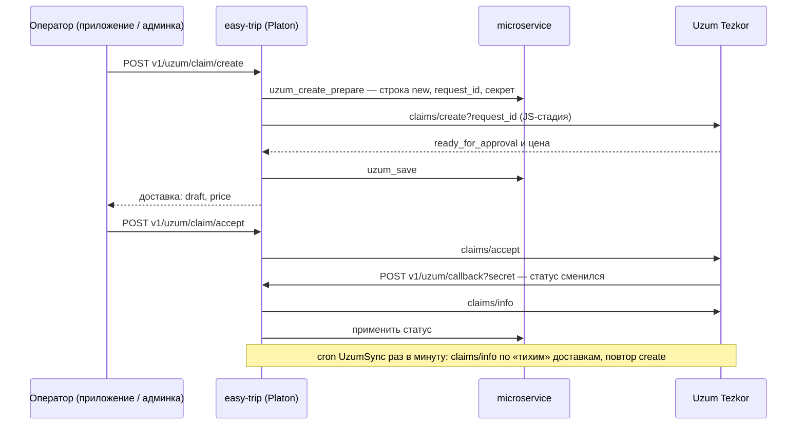

# EasyTrip — доставка курьерами Uzum Tezkor

Интеграция easy-trip (конструктор Platon) с Uzum Tezkor Cargo API: курьер везёт заказ от объекта
(ресторан, магазин) до покупателя. Заказ оплачен **заранее онлайн**, выкупа нет — курьер только
везёт. Курьера вызывает **оператор объекта** (в easy-trip нет модели заказа, см. «Вопросы»).

**Статус на 24.11.2026.**
- Документация Uzum разобрана, тестовый стенд проверен руками: токен рабочий; расчёт, создание,
  повтор с тем же `request_id`, изменение и отмена работают. Три расхождения с письмом Бахтиёра —
  в [[API-Uzum-Tezkor]].
- Готовы миграция `01-DDL.sql` (microservice), пакет `P01` (platon: 12 эндпоинтов и cron),
  откат и шаблон подключения точки.
- Проверено локально: PostgreSQL 17.11 с дампом прода от 02.11.2026, эмулятор стадий
  `tools/emu.py` — 68 проверок, JS-стадии ходят в **настоящий тестовый стенд Uzum**. Все заявки
  эмулятор в конце отменяет.
- **На сервер не накатано.** Полного прогона с курьером не было: на стенде курьеров нет,
  назначает Бахтиёр вручную — договориться о времени.

**Файлы**

| Файл | Что внутри |
|---|---|
| [[API-Uzum-Tezkor]] | выжимка API Uzum и что проверено на стенде |
| [[Эндпоинты-easy-trip]] | **контракт для приложения и админки**: 12 эндпоинтов, поля, ошибки, сценарий |
| [01-DDL.sql](01-DDL.sql) | **в microservice**: таблицы `uzum_*`, вью, 40 функций; одна транзакция |
| [02-Откат.sql](02-Откат.sql) | удаляет всё из 01 вместе с данными (точки с токенами, доставки) |
| [03-Точки-и-операторы.sql](03-Точки-и-операторы.sql) | шаблон: администратор, операторы, точка с токеном, переход на боевой токен |
| [P01-Platon-API-Uzum.sql](P01-Platon-API-Uzum.sql) | **в platon, после 01**: эндпоинты, стадии, cron `UzumSync` |
| [tools/gen_p01.py](tools/gen_p01.py) | генератор P01: править эндпоинты здесь, потом `python -I tools/gen_p01.py P01-Platon-API-Uzum.sql` |
| [tools/emu.py](tools/emu.py) + [tools/js_stage.js](tools/js_stage.js) | эмулятор стадий: SQL — в локальном microservice, JS — в Node с запросами к стенду Uzum |
| [Uzum-easy-trip.postman_collection.json](Uzum-easy-trip.postman_collection.json) | **запросы для проверки на сервере** (11, по порядку): импорт в Postman, токенов внутри нет; генератор — [tools/gen_postman.py](tools/gen_postman.py) |

Связано: [[EasyTrip-БД/Platon-эндпоинты|как вставлять эндпоинты SQL-ом]],
[[EasyTrip-Бонусные-карты/00-Обзор|бонусные карты]] (тот же подход: функции + генератор + эмулятор),
[[EasyTrip-RealPay/00-Обзор|RealPay]] (онлайн-оплата).

## Как устроено



- **Таблицы** (microservice): `uzum_settings` (адреса контуров, callback, режимы), `uzum_points`
  (точка забора и её токен: одна активная на объект или филиал, `env` test / prod),
  `uzum_operators` (кто вызывает курьера; `place_id` пустой — администратор), `uzum_claims`
  (доставка), `uzum_claim_events` (смены статуса, ошибки, callback-и), вью `uzum_claims_v` —
  ответы без токенов и секретов.
- **Эндпоинт с вызовом Uzum** — три стадии: `prep` (SQL-функция собирает вызовы и токен точки в
  JSON `calls`), `uz` (JS-стадия выполняет их через `http.post` / `http.get`, ошибку HTTP ловит в
  `_error`), `_body` (SQL разбирает ответ, пишет доставку, отдаёт строку). JS-стадия одна на все
  эндпоинты — меняется только имя стадии-источника.
- **Статусы** приходят callback-ом; cron раз в минуту спрашивает `claims/info` по доставкам без
  новостей дольше 2 минут (у черновиков и доставленных — 10) и повторяет `create` для зависших `new`.

## Решения

1. **Логика — в SQL-функциях, стадии тонкие** (как в бонусных картах): всё проверяется на локальной
   копии, стадии собирает генератор.
2. **Без выкупа.** Оплата заранее, поэтому `buyout` / `payment_on_delivery` не передаём; цены
   позиций курьеру справочно. Позиций может не быть — тогда одна «Заказ ET-…» с ценой 0 (стенд
   принимает).
3. **Токен на точку.** Uzum выдаёт токен на филиал — `uzum_points`, одна активная точка на объект
   (филиал). Тест и прод различаются полем `env` точки.
4. **Курьера вызывает оператор** (`uzum_operators`). Цену (`calculate`) и список точек может
   смотреть любой вошедший. В easy-trip ролей нет — права проверяют функции.
5. **Callback не доверяем.** Подписи у Uzum нет, а дойдут ли query-параметры POST до `#secret`,
   неизвестно. Поэтому callback только сигнал: по известной заявке запрашиваем `claims/info` и
   применяем его. Неверный секрет — игнор; секрета нет — всё равно через `claims/info`.
   Подделки пишутся как `callback_bad` и не мешают защите от повторов.
6. **Без дублей курьера.** Строка с `request_id` сохраняется до вызова Uzum (`has_transaction =
   false`): сбой связи не теряет заявку, повтор (cron, 10 минут) возвращает ту же заявку Uzum.
   Повтор `create` с тем же `order_ref` — та же доставка; на другой адрес — ошибка `uzum_order_busy`.
7. **Ошибки Uzum понимаем при любом поведении платформы**: `http.post` на 4xx бросает исключение
   (текст с телом в `_error`) или отдаёт тело — `uzum_result_error` разбирает оба, эмулятор
   проверяет оба.
8. **Тело `http.post` — строкой JSON** из SQL (числа точно как в jsonb). Если платформа на сервере
   портит строку, режим переключается без пересборки: `uzum_settings.js_body_mode = 'object'`.
   Что работает — покажет `GET v1/uzum/diag`.
9. **Платная отмена — только с `allow_paid = true`**; без него — цена отмены в ответе.
10. **Без `claims/edit`.** До подтверждения проще отменить (бесплатно) и создать заново; к тому же
    `edit` отвечает старыми данными. Если понадобится — отдельной функцией.
11. **Телефон** приводится к `+998…`, координаты проверяются на Узбекистан (ловит перепутанные
    lon / lat до вызова Uzum).

## Проверка на сервере

1. microservice: `01-DDL.sql` (DataGrip, весь файл). Ждём 5 таблиц `uzum_*` и 40 функций.
2. platon: `P01-Platon-API-Uzum.sql` (весь файл). Проверки в конце: 12 эндпоинтов, 32 стадии,
   у `UzumSync` `has_basic = true`.
3. microservice: из `03-Точки-и-операторы.sql` — блок 3 (тестовая точка **в Ташкенте** с тестовым
   токеном) и блок 1 (себя администратором; свой `user_id` — запрос `01 me` из коллекции Postman).
   Блоки копировать в консоль, сам файл не править: DataGrip сохраняет правки на диск — токен попал
   бы в git.
4. `GET v1/uzum/me` → `is_admin = true`.

   Шаги 4–7 — запросы `01`–`07` коллекции [Uzum-easy-trip.postman_collection.json](Uzum-easy-trip.postman_collection.json).
   В переменных коллекции: `et_token` — свой токен easy-trip (только в Current value), `place_id` —
   объект тестовой точки. `05 create` сам сохраняет id доставки для `06`–`11`. Тела запросов
   проверены на локальной копии через те же функции (26.11.2026).
5. `GET v1/uzum/diag` → `info404_code = not_found`; `info404_how` — `exception` или `body` (оба
   поддержаны); `calc_string_ok = true`.
   - `calc_string_ok = false`, а `calc_object_ok = true` →
     `update project.uzum_settings set value = 'object' where code = 'js_body_mode';`
   - `info404_how = platform_result` — результат JS-стадии подставляется не JSON-ом: смотреть
     `raw_info404`, это надо чинить до запуска.
6. `POST v1/uzum/calculate` (адрес в Ташкенте) → цена.
7. `POST v1/uzum/claim/create` с тестовыми данными (телефон `+998000000002`), `GET v1/uzum/claim/info`,
   `POST v1/uzum/claim/cancel`.
8. Через минуту — дошли ли callback-и и доходит ли `#secret`:
   ```sql
   select source, status, secret_ok, note, created_at
   from project.uzum_claim_events
   where source like 'callback%'
   order by id desc
   limit 20;
   ```
   `secret_ok = true` — query доходит; `null` — нет (статусы всё равно верные, секрет просто не
   проверяется). Пусто — callback до нас не дошёл: проверить у Бахтиёра, что Uzum получает 200.
9. Cron: `select last_run_time, details from cron_schedules where name = 'UzumSync';` — без ошибок.
10. **Полный прогон с Бахтиёром:** `create` → `accept` → он назначает курьера → статусы до
    `delivered_finish`, `courier` (имя, телефон, координаты, ссылка), отдельно — отмена после
    забора (`paid_cancel_not_confirmed`, потом `allow_paid = true`).

## Не проверено (риски)

- Как платформа отправляет строку в `http.post` и подставляет результат JS-стадии в SQL
  (`:uz::text`). У HTTP-стадии RealPay это работает так же; на сервере — шаг 5.
- Дойдут ли query-параметры POST до `#secret` — шаг 8; на верность статусов не влияет.
- HTTP-код ответа платформы на callback: Uzum считает успехом только 200.
- Таймаут `http.post` на платформе неизвестен; Uzum отвечает за 0,1–0,4 секунды.
- `v1/uzum/callback` открыт: любой запрос оставляет строку в `uzum_claim_events`. Мусор чистится
  по `source = 'callback_bad'`.

## Вопросы

**К Uzum (Бахтиёр):**
1. Назначить курьера на тестовую заявку — договориться о полном прогоне.
2. Подтвердить пути: `performer-position` — GET, телефон — `/v2/driver-voiceforwarding` (в письме
   иначе, стенд принимает только так). Так же ли на проде?
3. Боевой токен: выпуск на каждую точку — что для этого нужно.
4. С каких адресов приходят callback-и (если захотим ограничить).
5. Нет ли ограничений на позицию с `cost_value` `"0"` (шлём, когда позиций нет).

**Решить нам:**
1. Кто вызывает курьера: оператор объекта (сделано) или приложение само после оплаты — тогда
   нужна модель заказа (корзина, оплата RealPay → доставка), её в easy-trip нет.
2. Какие объекты подключаем первыми; чей договор с Uzum — объекта или easy-trip как агента
   (от этого зависит, кому выпускают токены и кто платит за доставку).
3. Нужна ли страница в админке конструктора: точки, операторы, список доставок (API готово).

## Следующие шаги

1. Накатить на сервер (шаги 1–3) и пройти проверку 4–9.
2. Полный прогон с Бахтиёром (шаг 10).
3. Ответы на «Решить нам» → экран оператора в приложении или админке.
4. Боевой токен → точка с `env = 'prod'`, тестовую выключить (блок 5 в `03`).

## Откат

- microservice: `02-Откат.sql`.
- platon:
  ```sql
  begin;
  delete from api_stages s using api_endpoints e where s.endpoint_id = e.id and e.path like 'v1/uzum/%';
  delete from api_endpoints e where e.path like 'v1/uzum/%';
  delete from cron_schedules c where c.name = 'UzumSync';
  commit;
  ```

## Как проверялось

Локально (PostgreSQL 17 на 5435 запускать из своей консоли:
`pg_ctl -D D:/tools/pgdata17 -l D:/tools/pgdata17/server.log start`):

1. `python -I tools/gen_p01.py P01-Platon-API-Uzum.sql`, затем `P01` — в локальный platon
   (`psql -d platon -f …`). Если стадии менялись — сначала удалить старые (раздел «Откат», platon).
2. `python -I tools/emu.py <папка для временных файлов> --fresh` — откат и `01` заново в
   локальном microservice, затем 68 проверок. Тестовый токен — из `UZUM_TEST_TOKEN` или файла
   `D:\code\easytrip-local-db 2\uzum-test.env` (вне git).

Что проверяет эмулятор (24.11.2026, всё прошло):
- разбор ошибок Uzum в обоих поведениях платформы, деньги строкой, телефоны, этапы;
- права: гость, оператор, администратор, без входа;
- `diag`; `calculate` — courier, express, Самарканд (`estimating.route_too_long`), перепутанные
  координаты, объект без точки;
- `create` — черновик с ценой, `callback_url` с секретом, вес × количество, повтор и конфликт по
  `order_ref`, без позиций, `auto_accept`;
- callback — подделка, свой секрет, повтор, чужая заявка, без секрета;
- `accept`, `courier` до назначения курьера (409 — не ошибка), `cancel` (бесплатная и платная —
  на подставленном ответе), путь статусов в событиях;
- cron — повтор потерянного `create` тем же `request_id`, опрос «тихой» доставки, пустой запуск;
- списки и фильтры; в конце на стенде нет активных заявок.
