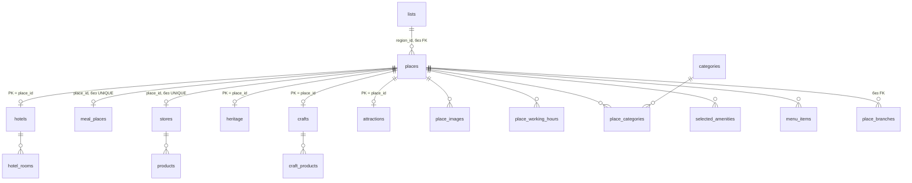

# EasyTrip — локальная копия прод-БД (разбор дампа)

Папка: `D:\code\easytrip-local-db 2` (свой локальный git от aider, без remote).
Дамп снят **02.11.2026 10:38 UTC** с прод-сервера (снимал коллега; `dump.sh` рассчитан на macOS).
Разбор — 04.11.2026, по тексту дампа (восстановить в Docker не удалось, см. «Как восстановить»).

Связано: [[EasyTrip-RealPay/00-Обзор|RealPay]], [[EasyTrip-TripAdvisor/00-Обзор|TripAdvisor]],
[[EasyTrip-Список-объектов]], [[Туризм]]. Устройство эндпоинтов конструктора —
[[EasyTrip-RealPay/Эндпоинты-easy-trip#Как устроен эндпоинт конструктора]].

> [!warning] Дамп секретный
> В `platon.sql` — пароли и ключи в открытом виде, в `microservice.sql` — персональные данные
> (ПИНФЛ, паспорта, телефоны). README пишет, что личных данных нет, — это не так.
> Не класть в git с remote, не отдавать облачным сервисам. Подробно — «Безопасность».

## Что в пакете

| Файл | Что это |
|---|---|
| `README.md` | инструкция на узбекском (латиница) |
| `docker-compose.yml` | `postgres:17`, контейнер `easytrip-db`, порт `127.0.0.1:5434`, `postgres`/`postgres`, том `easytrip_pgdata`, `./dumps` → `/dumps` (только чтение) |
| `restore.sh` | поднимает контейнер, пересоздаёт базы `microservice` и `platon`, заливает дампы, создаёт 3 последовательности в platon |
| `dump.sh` | чем снимали дамп (путь Homebrew, к нам не относится) |
| `dumps/microservice.sql` | 46 МБ, 131 тыс. строк, `pg_dump -Fp`, только схема `project` |
| `dumps/platon.sql` | 1,6 МБ, схема `public` |
| `dumps/DATE.txt` | дата снятия |

Две базы:
- **`microservice`**, схема `project` — данные приложения: объекты, фото, справочники, платежи.
- **`platon`**, схема `public` — метаданные конструктора Platon: API-эндпоинты и их стадии
  (SQL — в `api_stages.attributes->>'sql'`), страницы админки, меню, формы, cron.

## Как восстановить (Windows)

1. Docker Desktop должен быть запущен (как чинить зависание — в памяти, «Docker Desktop: зависшие сокеты»).
2. Перед заливкой создать `uuid-ossp` **в схеме `project`**: колонка `app_versions.id` имеет
   default `project.uuid_generate_v4()`, а `restore.sh` ставит расширение в `public` —
   без этого таблица `app_versions` не создастся.
   ```sql
   create schema if not exists project;
   create extension if not exists "uuid-ossp" with schema project;
   ```
3. `restore.sh` запускать из Git Bash так: `MSYS_NO_PATHCONV=1 ./restore.sh` — иначе Git Bash
   превращает `/dumps/microservice.sql` в `C:/Program Files/Git/dumps/...`, и psql в контейнере
   файл не найдёт.
4. Ожидаемые ошибки (не страшны): FK `user_table_column → auth.pa_auth_users` (схемы `auth` нет),
   повторное `CREATE SCHEMA project`. `restore.sh` прячет ошибки через `grep -v` и показывает
   только 5 последних строк — настоящие ошибки можно не заметить.
5. Проверка: `places` = 7 486, `api_endpoints` = 119.

Первая строка дампа — `\restrict` (psql ≥ 17.6; в контейнере `postgres:17` есть). Заливать только
через psql: DBeaver/pgAdmin не понимают `COPY … FROM stdin` и мета-команды.

## База `microservice`: модель

Центр — **`places`**: все объекты в одной таблице, тип — enum `place_type`. Вокруг:



| Группа | Таблицы (строк) |
|---|---|
| Объекты | `places` 7 486 |
| Расширения 1:1 по типу | `heritage` 4 128, `crafts` 2 107, `stores` 439, `meal_places` 344, `hotels` 326, `attractions` 40, `content_places` 3; пустые: `finances`, `medicals`, `mosques`, `shoppings`, `taxi_companies`, `rent_car` |
| Дочерние 1:N | `place_images` 24 194, `place_categories` 7 484, `place_working_hours` 5 602, `selected_amenities` 1 221, `hotel_rooms` 412, `craft_products` 134, `place_branches` 70, `menu_items` 23, `products` 23; пустые: `place_reviews`, `rent_car_items`, `transport_tariffs` |
| Справочники | `lists` 676, `cities` 808, `countries` 100, `categories` 105, `amenities` 84 |
| Файлы | `files` 27 405 — только метаданные; сами файлы (20,6 ГБ) на файловом сервере, ссылка `https://easy-trip.com/file/api/v1/public/download/image/<file_id>` |
| Импорт и сырьё | `tx_onkm` 13 258, `rent` 11 414, `temp_rent` 11 083, `cadastre` 1 823, `tx_objects` 1 724, `temp_cadaster` 1 604, `accommodation_registry` 1 280, `madaniy_meros` 443, `ya_img_people_hidden` 45 |
| Платформа | `project_translations` 431 (FRONTEND), `app_versions` 1 |
| Пустые в дампе (личные данные) | `auth_users`, `bookings`, `contact_requests`, `hicool_clients`, `mail_messages`, `merchant`, `project_user_logs`, `realpay_transaction`, `registered_qr_codes`, `sms_messages`, `user_table_column` |

`lists` — общий справочник (`type_id`): 1 — регионы (15, с GeoJSON и префиксом QR в `key1`),
2 — районы (207), 3 — махалли/массивы (278), 4 — типы отелей, 5 — удобства, 6 — питание,
7 — кухни, 8 — месяцы, 9 — настройки RealPay, 10 — типы объектов наследия,
11 — организационно-правовые формы, 12 — категории товаров, 13 — шаблон кассы.

Блок `cadastre` / `rent` / `tx_*` к туризму напрямую не относится: кадастр, договоры аренды,
торговые точки с онлайн-ККМ (число и сумма чеков). Похоже на инвестиционную часть —
пакет приложения `uz.realsoft.travel.invest`. Уточнить.

### Функции и триггеры

- `trg_places_set_region` (до INSERT и UPDATE OF lat/lon) → `fn_region_id(lat, lon)`: точка в
  полигоне регионов из `lists` type 1 (свой ray casting на plpgsql), меньший bbox выигрывает,
  запасной вариант — ближайший bbox. Порядок аргументов `(lat, lon)`, а у `fn_pt_*` — `(lon, lat)`.
- `trg_generate_qr_id` на `registered_qr_codes`: если `qr_id` пуст — `reg_num = max + 1` по
  региону, `qr_id = key1 региона + контрольная цифра Луна + lpad(reg_num, 4)`.
- Утилиты: `get_name_by_locale`, `locale_to_text`, `mm_coord` (градусы-минуты-секунды → число),
  `mm_nz` (чистка `null`/`undefined`/`-` при импорте).
- Наследие шаблона платформы, easy-trip не нужно: миграции пользователей в `auth.pa_auth_users`,
  `changecreated_by`/`changeupdated_by`, `pbkdf2*` (вызывает несуществующую `project.hmac`),
  `send_user_password_sms` (текст «i-talim.uz…»), `search_everywhere`, около 40 последовательностей
  `seq_*` от других проектов (educators, mfo, org_passport…).

## Данные

- Типы: памятники `HISTORICAL_MONUMENTS` 3 405, ремесленники `CRAFT` 2 107, наследие
  `CULTURAL_HERITAGE` 724, магазины 439, заведения питания 349, отели 326, `ATTRACTION` 79,
  `EATERY` 40, мечети 17. Из 20 значений enum используются 9.
- Источник (`source`): `madaniymeros` 4 121, `hunarmandlar` 2 106, `yandex` 887, вручную 372.
  7 193 из 7 486 созданы в октябре 2026 — массовые импорты.
- Регионы: Бухара 3 567 (48 %), Сурхандарья 473, Навои 459, Ташкент 398, Ташкентская обл. 380,
  Самарканд 365… У 127 регион пуст.
- Языки: `name_ru` — 2 %, `name_en` — 4 %, `description_uz` — 22 %, `description_ru/en` — 2 %.
  `_uz` в `places` — фактически узбекская латиница (7 360 из 7 486), хотя в `lists` `name1` —
  кириллица, `name4` — латиница, а `get_name_by_locale` различает `uz` и `la`.
- 29 % без координат (2 074 ремесленника + 111 памятников), 32 % без фото (почти все ремесленники).
- `ta_id` — не только TripAdvisor: `mm:<id>` — Маданий мерос, `ya:<id>` — Яндекс, голые числа —
  TripAdvisor (около 120). Ремесленники внешний id хранят в `crafts.external_id`.
- Тестовый мусор: 33 записи в точке 41.3111, 69.2797 (центр Ташкента): «Ichan-Qala Hotel» ×12,
  `vhhbgghhjj`, `test`; «Bibixonim mehmonxonasi» ×12, «Milliy taomlar» ×16; около 59 записей с
  мусорными именами; 14 мест вне Узбекистана (4 с нулевыми координатами).
- `state` × `moderator_status`: у 211 отклонённых модератором `state = 1`; `state = -1` (удалённые) — 39.
  Комментарий к колонке (0/1/2/3) с фактом не совпадает: модерация переехала в `moderator_status`.
- `hotel_rooms`: цены в USD (228) и UZS (184) вперемешку.

## База `platon`

- Как устроены `api_endpoints` и `api_stages` и как вставлять их SQL-ом — [[Platon-эндпоинты]].
- 119 эндпоинтов: 27 рабочих **без авторизации**, 11 с Basic (callback-и RealPay), 77 с Bearer,
  4 выключены. 287 стадий: `sql_select` 97, `js_eval_handler` 48, `sql_insert` 47,
  `sql_bulk_insert` 37, `http_request_handler` 24, `sql_update` 17, `static_json` 14.
- Отрицательные id (−1…−15) — эндпоинты, перенесённые из edu-проекта (RealPay).
- Версии одного и того же: `content-places/list` v1/v2/v3, `landing` v1/v2, `filter/search`,
  `hotels`/`meal-place`/`store` v1 и v2.
- Админка: меню «Дашборд», «Объекты», «Временные объекты», «Обидалар», «Модератор»,
  «Добавить бизнес», «Hicool-monitoring»; 23 страницы.
- Cron: один — обновление токена RealPay, выключен после ошибки 401.
- `env_group`/`env_item` (переменные окружения платформы) пустые — секреты лежат прямо в стадиях.

## Проблемы

### Безопасность

1. **Секреты в стадиях `platon`** (значения сюда не переписаны):
   - `POST v1/login` — без авторизации; в JS — логин и пароль администратора платформы
     (`userActions.loadToken`), вторая стадия создаёт пользователя платформы. Проверить, что
     токен администратора не уходит в ответ; эндпоинт выключить или закрыть авторизацией.
   - RealPay: учётка агента (stage) в `v1/stage/real-pay/token`; там же учётки merchant-billing и
     payment для stage **и prod** (стадии выключены, но данные лежат); пароли в JS
     `v1/real-pay/token`, `v1/real-pay/auth/sdk`; Basic callback-ов в
     `v1/stage/real-pay/create/template`.
   - Stripe: секретный тестовый ключ (`sk_test_…`) в `v1/stripe-card`, три стадии.
   - TripAdvisor: ключ прямо в URL `v1/tripedvisor/location/nearby_search` и
     `v1/tripedvisor/main-datas` — эндпоинты публичные, квоту может выжечь кто угодно.
   - Basic к внешним сервисам: `v1/org-data` (два), `v1/madaniy-meros`, `v1/cadastre`, `test/v1/cadastre`.
   - `microservice.lists` type 9 id 1 — сохранённый JWT RealPay (stage).

   → сменить пароли и ключи, вынести в `env_item`.
2. **Персональные данные в «обезличенном» дампе**: `crafts` — 1 877 ПИНФЛ, паспорта, даты
   рождения, домашние адреса; `rent`/`temp_rent` — имена и телефоны арендаторов и владельцев
   (около 11 тыс.); `tx_onkm` — 13 258 телефонов; `accommodation_registry` — ФИО, телефоны,
   e-mail; `cadastre`, `madaniy_meros` — владельцы. Попросить коллегу исключить эти колонки.
3. **Выдача без модерации**: публичные `v1/publick/places` и `v1/recommended` фильтруют только
   `state = 1` — 211 отклонённых могут попадать к пользователям (лендинг и карта фильтруют
   `ACCEPTED` правильно). `v1/qr/registers` отдаёт список QR без авторизации.

### Целостность и схема

4. `accommodation_registry_id_seq` = 1279, а `max(id)` = 1280 (строку вставили с явным id) —
   следующая вставка упадёт на дубликате ключа. Лечится `setval(…, max(id))`.
5. QR: при `reg_num` ≥ 10 000 `lpad(…, 4)` обрежет номер → дубль `qr_id`; `max + 1` в триггере —
   гонка при параллельных вставках (вторая упадёт на unique); `reg_num` — smallint.
6. Нет внешних ключей: `places.region_id` (у `lists` составной PK), `places.sub_category_id`
   (16 ссылок в никуда), `city_id`, `countries_id`, `place_branches.place_id`,
   `selected_amenities.amenity_id`, `merchant.place_id`, `realpay_transaction.place_id`,
   `registered_qr_codes.place_id`, `place_images.file_id` (82 файла не найдены в `files`),
   `category_id` в `meal_places`/`stores`/`content_places`.
7. 1:1 сделано по-разному: у `meal_places` и `stores` PK — свой `id`, а `place_id` без UNIQUE
   (дублей пока нет, но ничто не мешает); у остальных PK = `place_id`. FK у `meal_places`
   называется `restaurants_pkey`, PK `place_branches` — `meal_place_branches_pkey` (следы переименований).
8. `ON DELETE`: `place_images`, `menu_items`, `products` → `places` без CASCADE, остальные с
   CASCADE. На деле удаление мягкое (`state = -1`), но жёсткое упадёт.
9. Индексов почти нет: `places(place_type)`, `places(region_id)`, `places(state, moderator_status)`,
   `place_working_hours(place_id)`, `place_categories(category_id)`, `hotel_rooms(hotel_id)`,
   `menu_items(place_id)`, `files(record_id)`… Расстояния считаются формулой по сфере по всей
   таблице, без bbox-предфильтра. На 7,5 тыс. мест незаметно, при росте — заметно.
10. `place_type`: `EATERY` (40 мест, без строки-расширения), `MEAL_PLACE` и `RESTAURANT` — один
    смысл; у `MOSQUE` (17) нет строк в `mosques`; `ATTRACTION` 79, а в `attractions` — 40.
11. Типы: даты строками (`accommodation_registry.issue_date` в формате M/D/YYYY, `crafts.birth_date`,
    `temp_*`); координаты numeric в `places`, double в `place_branches`, varchar в `madaniy_meros`;
    почти везде `timestamp` без зоны, но `timestamptz` в `attractions` и `contact_requests`.
12. Три способа делать UUID: `gen_random_uuid()`, `uuid_in(md5(random()||clock_timestamp()))`,
    `project.uuid_generate_v4()`.

### Эндпоинты

13. Сломанные и устаревшие: `v1/trip` → `select * from test` (таблицы нет); боевые
    `v1/real-pay/callback/*` — из edu, работают с `students`/`students_payments` (переписаны
    только stage-версии); `v1/stage/real-pay/create/iframe-token` — тоже edu;
    `POST v1/places` (выключен) ссылается на `restaurants`.

### Пакет

14. `dump.sh` не совпадает с тем, чем реально снимали: в `platon.auth_users` нет данных,
    `cars`/`table_name`/`themes_entity` исключены без флагов в скрипте.

## Неизвестно, спросить

- Назначение блока `cadastre`/`rent`/`tx_*` и связь с инвестиционной частью.
- Нужны ли пустые расширения (`finances`, `medicals`, `mosques`, `shoppings`, `taxi_companies`, `rent_car`).
- Где живёт схема `auth` (`pa_auth_users`) — в дамп не входит.
- Что возвращает `POST v1/login` (см. п. 1).

## Мусор от Qwen (убран 04.11.2026)

- `);` и «Пример ожидаемого формата для файла» — обрывки ответа модели: aider принял их за имена
  файлов и закоммитил. Удалены через `git rm`, удаление не закоммичено.
- `docs/PROJECT_KNOWLEDGE.md` — пустой (Qwen так ничего и не записал), удалён вместе с `docs/`.
- Служебные файлы aider (`.aider.*`, `.aiderignore`, `.gitignore`) оставлены. В
  `.aider.chat.history.md` — выдуманный Qwen «анализ» (таблицы users/trips/bookings, папки
  `migrations/`), дамп он так и не прочитал. Опираться на него нельзя.
