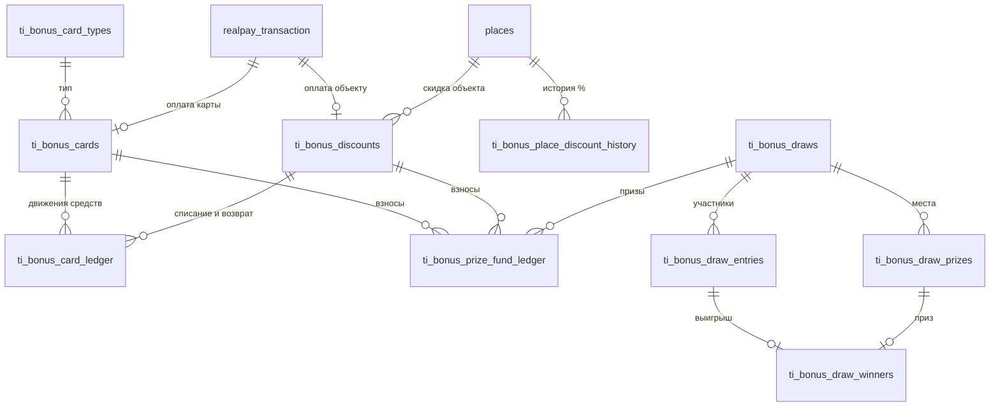

# EasyTrip — бонусные (скидочные) карты и розыгрыши

Новая часть проекта: realsoft продаёт туристам скидочные карты, объекты easy-trip дают скидку
держателям, по потраченным скидкам разыгрываются денежные призы. Схему создают на сервере в
`microservice`.

**Статус на 05.11.2026.**
- DDL готов и проверен на PostgreSQL 17.11 с дампом прода от 02.11.2026: 92 проверки и два
  теста гонок прошли.
- Ответы на все вопросы получены. На прод не накатывался.
- Ждём мерчанта Realsoft в RealPay (документы согласуются): без него нет эндпоинта покупки
  карты (раздел «Ждём»).

**Файлы**

| Файл | Что внутри |
|---|---|
| [01-DDL.sql](01-DDL.sql) | таблицы, функции, триггеры; одна транзакция |
| [02-Откат.sql](02-Откат.sql) | удаляет всё, что создал DDL, вместе с данными |
| [03-Тесты-локально.sql](03-Тесты-локально.sql) | сценарии с точными суммами; **только для локальной копии** |

**Источники и связи**
- Описание Муталиба и его ответы на вопросы (05.11.2026).
- Статья Насруллаева Ҳ. Ҳ. «Инновацион IT-платформа ёрдамида туризм соҳасини янада
  ривожлантириш имкониятлари» (`Туризм соҳасини ривожлантириш v2.docx`) — концепция, не ТЗ.
- Связано: [[EasyTrip-БД/00-Обзор|разбор прод-БД]], [[EasyTrip-RealPay/00-Обзор|RealPay]], [[Туризм]].

## Правила (итог после ответов 05.11.2026)

### Карты
- **Типы.** X2 / X5 / X10, цена (номинал) $20 / $50 / $100. Карта виртуальная: номер из
  16 цифр, последняя — контрольная по Луну; QR нет.
- **Накопление — по статье.** При покупке сразу 1× номинала, затем +1× каждые 7 дней,
  пока не наберётся 2× / 5× / 10× ($40 / $250 / $1000). X2 копится 1 неделю, X5 — 4, X10 — 9.
- **Пользоваться** можно и частично накопленным.
- **Ограничений нет:** к странам карты не привязаны, серий и тиража нет.
- **Несколько карт у туриста.** Списание с самой старой, остаток — со следующей.
- **Оплата карты** — только RealPay, в сумах по курсу ЦБ на день покупки (целые сумы).
- **Рефералка — позже.** При покупке уже сохраняется, кто привёл.

### Скидка
- **Где.** Только при оплате через RealPay в приложении: турист сканирует QR объекта и платит.
  Объект должен быть активен (`state = 1`) и пройти модерацию (`ACCEPTED`).
- **Размер.** Один % на объект — существующая `places.card_discount_percentage`. Плюс
  необязательный потолок за чек (новая `places.card_discount_max_usd`) и история изменений.
- **Формула.** Скидка = min(цена × %, остаток карт, потолок), в целых сумах. К оплате должно
  остаться не меньше 1000 сум — это `min_amount` кассы RealPay.
- **Валюта.** Остатки и веса — в $. В каждой операции хранятся сумма в сумах и курс ЦБ на дату.
- **Отмена оплаты.**
  - Чек ещё не попал в зафиксированный розыгрыш — скидка возвращается на карты, взносы в
    фонды снимаются.
  - Уже попал — средства не возвращаются, взносы остаются. Иначе «оплата → розыгрыш →
    отмена» давала бы шансы даром.
  - В следующих розыгрышах отменённый чек не участвует.
- **Кэшбек и апгрейд — позже.**

### Сгорание
- **Когда.** Каждый месяц по графику от даты полного накопления: + 1 месяц, + 2, ... Покупки
  график не сдвигают: средства сгорают, даже если турист активно ими пользуется.
- **Сколько.** Номинал ($20 / $50 / $100), а если остаток меньше — весь остаток.
- **Резерв не спасает.** Если в момент сгорания всё лежало в резерве неоплаченного платежа,
  сгорание сработает задним числом, когда резерв снимется.
- **Куда.** Сгоревшее идёт в шанс туриста в периоде, на который пришлось сгорание.

### Розыгрыши
- **Виды.** Ежедневные (сутки по Ташкенту) и за период, который задаёт компания.
- **Аудитории.** Туристы и объекты — отдельно, у каждой свой фонд.
- **Вес туриста** — потраченные скидочные средства плюс сгоревшие за период. **Вес объекта** —
  выданные им скидки. Шанс на следующий период не переходит.
- **Фонд.** Потраченное и сгоревшее делится на кратность карты (X2 — на 2, X5 — на 5, X10 —
  на 10) и пополам между туристами и объектами. За жизнь карты в фонды уходит вся её цена.
- **Пересечение.** Чек участвует во всех розыгрышах, чей период его накрывает: и в ежедневном,
  и в периоде компании.
- **Призы — только деньги.** Суммы и число мест вводит компания и платит из фонда. Один приз
  на участника.
- **Прозрачность.** Хранится ответ random.org с подписью и цепочка хешей розыгрышей.
  Кнопка «Старт» — позже.

## Модель



| Таблица | Зачем |
|---|---|
| `ti_currency_rates` | курсы ЦБ по датам (загрузка ответа cbu.uz) |
| `ti_bonus_card_types` | X2 / X5 / X10 и их условия, включая доли в фонды |
| `ti_bonus_cards` | карты; условия копируются при покупке, остаток — кеш |
| `ti_bonus_card_ledger` | все движения по картам — первоисточник, только добавление |
| `ti_bonus_discounts` | скидка в оплате RealPay: резерв → подтверждение / снятие / возврат |
| `ti_bonus_place_discount_history` | история % и потолка объекта (триггер на `places`) |
| `ti_bonus_prize_fund_ledger` | движения фондов туристов и объектов, только добавление |
| `ti_bonus_draws`, `_prizes`, `_entries`, `_winners` | розыгрыш, места, зафиксированные участники с диапазонами, победители и выплаты |
| `ti_bonus_errors` | сбои бонусов в триггере платежа |

Вью: `ti_bonus_prize_fund_balance` (остатки фондов), `ti_bonus_card_mismatches` (кеш ≠ журнал,
должно быть пусто).

**Существующие таблицы.** В `places` — колонка `card_discount_max_usd` и триггер истории.
В `realpay_transaction` — триггер на смену `status`.

**Почему так**
- Деньги считаются по журналу, остаток на карте — только кеш. Расхождение видно во вью, а
  правка задним числом невозможна: журналы, участники и победители защищены триггерами.
- Все операции идут функциями. Карты туриста блокируются всегда в одном порядке (старые
  первыми), поэтому две одновременные оплаты не спишут больше остатка. Тест: $30 + $5.78
  из $35.78, вторая оплата ждала первую.
- Начисления и сгорания пишутся со временем по графику, даже если cron отработал позже.
  Повторный запуск ничего не задваивает: в журнале уникальный индекс. График сгорания — по
  счётчику `burn_count` от даты накопления, поэтому «через 2 месяца» не съезжает с 31-го числа.
- Отмена оплаты и фиксация розыгрыша берут одну блокировку: отмена ждёт конца фиксации и по её
  итогу решает, возвращать ли средства. Тест: отмена ждала 2 секунды и средства не вернула.
- Статус платежа важнее бонусов. Сбой в триггере пишется в `ti_bonus_errors`, платёж
  сохраняется, а `ti_bonus_sync()` потом сводит расхождения.

## Как это работает

1. **Покупка карты.**
   - `ti_bonus_card_quote('X5')` возвращает цену в сумах по курсу.
   - Эндпоинт создаёт платёж RealPay на эту сумму, затем `ti_bonus_card_order(payment_id, 'X5', referrer)`
     создаёт карту в статусе `PENDING`.
   - При `SUCCESS` триггер активирует карту: номер, сразу $50, следующее начисление через 7 дней.
2. **Начисления и сгорания.** `ti_bonus_sync()` по cron вызывает `ti_bonus_cards_process_due()`.
   Оплата и `ti_bonus_user_cards()` догоняют график своей карты сами.
3. **Оплата объекту со скидкой.**
   - В `payment/create` после вставки платежа вызывается `ti_bonus_discount_apply(payment_id)`.
     Она резервирует средства и уменьшает `realpay_transaction.amount` до суммы к оплате.
   - Триггер реагирует на итог платежа: `SUCCESS` — подтверждение и взносы в фонды;
     `ERROR` — средства обратно; `CANCELLED` — возврат, если чек ещё не сыграл в розыгрыше.
   - Прежний неоплаченный платёж того же туриста снимается с резерва. Резерв без оплаты
     дольше 30 минут снимает `ti_bonus_sync()`.
4. **Розыгрыш.**
   - Компания создаёт розыгрыш: `ti_bonus_draw_create(...)` или `ti_bonus_draw_create_daily(...)`.
   - После конца периода `ti_bonus_draw_freeze(id)` фиксирует участников, веса и диапазоны
     билетов и списывает призы из фонда. Если фонда не хватает — ошибка.
   - Затем JS-стадия запрашивает у random.org `generateSignedDecimalFractions` с параметрами из
     `random_request`, добавив `apiKey`, и передаёт ответ в `ti_bonus_draw_run(id, ответ)`.
   - Тур *k*: билет = ⌊число × сумма весов оставшихся⌋ + 1. Победители прошлых туров выбывают.
5. **Проверка.** `ti_bonus_draw_chain_check()` пересчитывает хеши. Хеш каждого розыгрыша стоит
   публиковать (сайт, канал), иначе администратор базы может пересчитать всю цепочку.

## Что сделать в конструкторе

| Где | Что вызвать |
|---|---|
| cron, раз в несколько часов | GET `https://cbu.uz/uz/arkhiv-kursov-valyut/json/` → `select project.ti_currency_rates_load_cbu(:cbu::jsonb)` |
| cron, каждые 10 минут | `select project.ti_bonus_sync()` |
| cron, после 00:00 по Ташкенту | создать сегодняшние `ti_bonus_draw_create_daily('TOURIST' / 'OBJECT', сегодня)`; вчерашние — `freeze` → random.org → `run` |
| `v1/real-pay/payment/create` | после `payment_insert`: `select * from project.ti_bonus_discount_apply(:payment_insert.id::uuid)`; в ответ отдавать `pay_amount` вместо `amount` |
| новый эндпоинт покупки карты | `ti_bonus_card_quote` → вставка платежа на мерчанта Realsoft → `ti_bonus_card_order` (когда будет мерчант, см. «Ждём») |
| приложение | `select * from project.ti_bonus_user_cards(:user::uuid)`; типы — из `ti_bonus_card_types` |
| callback-и RealPay | менять не нужно, всё делает триггер |
| админка | розыгрыши и призы, пополнение фонда (`ADJUST`), выплаты (`payout_*` у победителей), мониторинг `ti_bonus_errors`, `ti_bonus_card_mismatches`, `ti_bonus_draw_chain_check()` |

**Ограничения**
- `user_id` в функции — только с сервера: из токена или из платежа.
- Из приложения вызывать только `quote`, `order`, `apply` (с платежом, созданным на сервере)
  и `ti_bonus_user_cards`. Остальное — триггер, cron и админка: `ti_bonus_card_activate` из
  приложения означало бы бесплатную карту.
- Чек ОФД в `/info`: сумма уже со скидкой. Нужно ли передавать полную цену и скидку
  отдельно — спросить RealPay.
- Тестовые платежи, на которые ссылаются карты или скидки, удалить нельзя (внешний ключ).

## Ждём

**Мерчант Realsoft в RealPay** — документы на 05.11.2026 согласуются. Когда будет готов:
- завести мерчанта в `merchant` без `place_id` и сделать эндпоинт покупки карты;
- решить с `realpay_transaction.place_id`: у платежа за карту нет объекта, а колонка NOT NULL.
  Предлагаю снять ограничение. Существующим callback-ам это не мешает: `/info` делает
  `left join places` и берёт имя мерчанта.
  ```sql
  alter table project.realpay_transaction alter column place_id drop not null;
  ```
  Второй вариант — технический объект в `places`, но он будет всплывать в списках объектов.

## Как проверялось

- **Окружение.** PostgreSQL 17.11 (EnterpriseDB), бинарники в `D:\tools\pgsql17`, кластер
  `D:\tools\pgdata17`, порт 5435, только localhost, без unix-сокетов. Дамп `microservice`
  восстановлен целиком.
- **Цикл.** Откат → проверка, что ничего не осталось → DDL → тесты. Из папки с файлами, база —
  локальная копия:
  ```bash
  psql -v ON_ERROR_STOP=1 -d microservice -f 02-Откат.sql
  psql -d microservice -c "drop schema if exists ti_bonus_test cascade; delete from project.realpay_transaction where kassa_id like 'TEST-K-%'; delete from project.merchant where kassa_id like 'TEST-K-%'; delete from project.places where name_uz like 'TEST %';"
  psql -v ON_ERROR_STOP=1 -d microservice -f 01-DDL.sql
  psql -v ON_ERROR_STOP=1 -d microservice -f 03-Тесты-локально.sql
  ```
  Успех — последняя строка `=== ВСЕ ПРОВЕРКИ ПРОЙДЕНЫ ===`. После тестов база не чистая:
  повторить откат и очистку.
- **Тесты (92 проверки).**
  - курсы, Луна, доли в фонды по кратности;
  - покупка через триггер; начисления и сгорания задним числом;
  - скидка с одной и с двух карт, потолок, отказ, возврат до розыгрыша;
  - снятие старого резерва, поздняя оплата с недостачей;
  - `ti_bonus_sync` при выключенном триггере, при истёкшем резерве и после сбоя триггера;
  - отзыв карты, история %;
  - розыгрыши туристов и объектов с точными билетами;
  - отмена оплаты после розыгрыша — средства не вернулись;
  - сгорание не сдвигается покупкой; резерв на момент сгорания не спасает средства;
  - пустой розыгрыш, нехватка фонда, отмена, ежедневные;
  - подмена суммы и веса — хеш не сходится.
- **Отдельно — две гонки.** Две оплаты одного туриста; отмена оплаты во время фиксации
  розыгрыша.
- **Найдено тестом.** Ошибка в откате: функция `ti_bonus_user_cards` держала таблицу. Исправлено.
