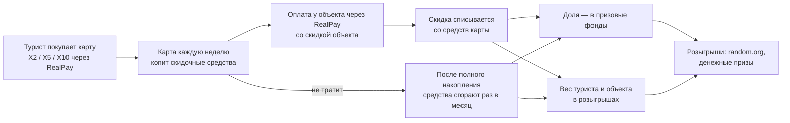
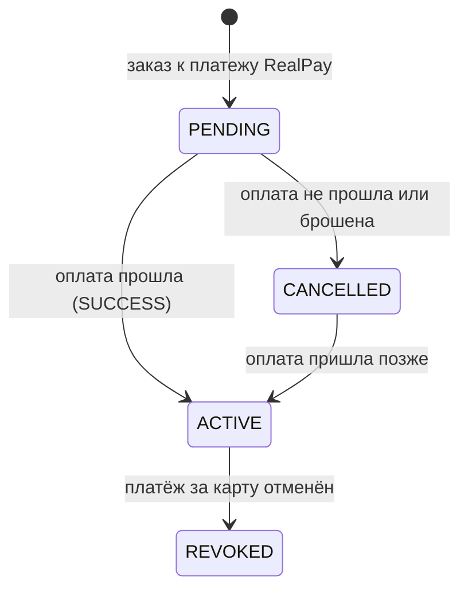
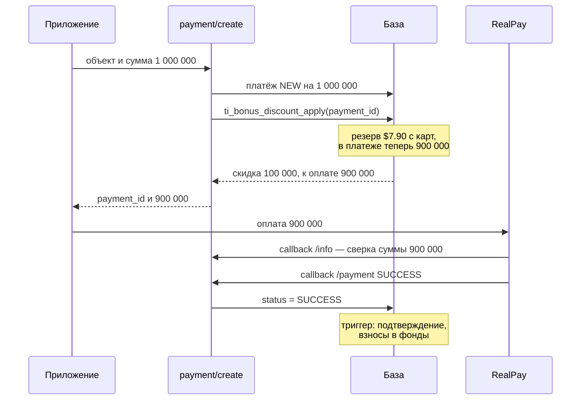
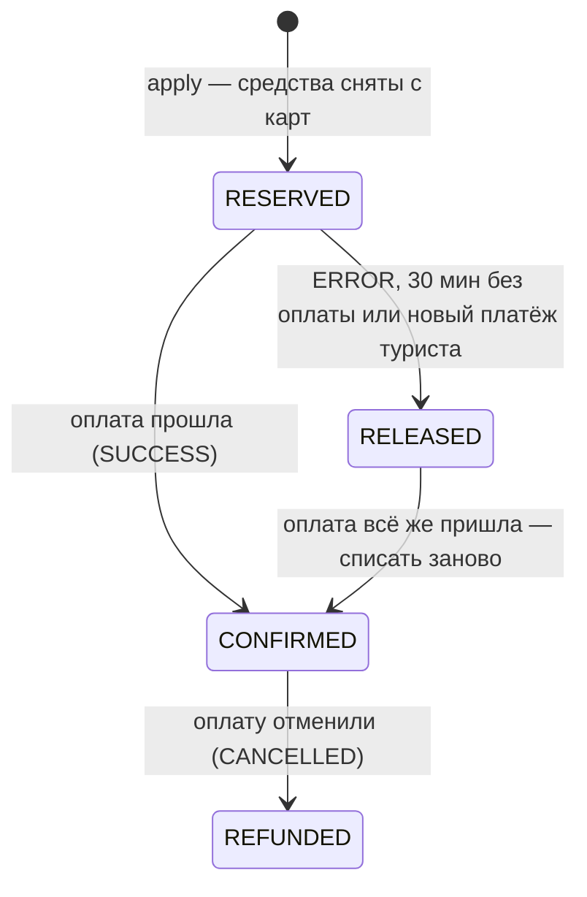
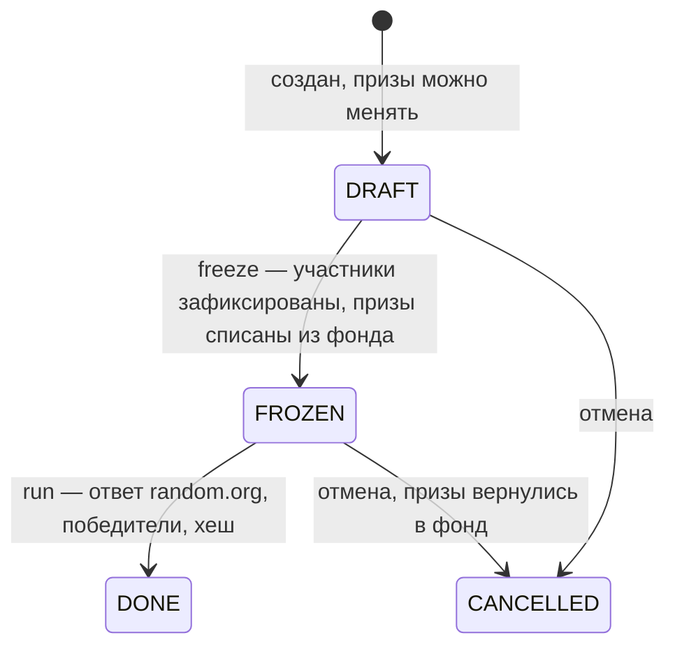

# Бонусные карты easy-trip: как работает модуль — с нуля

Документ объясняет модуль целиком: зачем он нужен, из чего состоит, что происходит с деньгами
на каждом шаге и почему сделано именно так. Короткая сводка решений — в [[00-Обзор]], код — в
`01-DDL.sql`. Все примеры посчитаны по курсу **12 650,43 сума за $1** — тем же, что в тестах.

**Содержание**
1. Идея в двух словах
2. Словарь
3. Карта: типы, покупка, жизненный цикл
4. Начисления
5. Сгорание
6. Скидка при оплате у объекта
7. Отмена оплаты
8. Призовые фонды
9. Розыгрыши
10. Прозрачность: random.org и цепочка хешей
11. Курсы валют, округление, время
12. Надёжность
13. Объекты базы
14. Кто что вызывает
15. Что сейчас на сервере и что дальше
16. Шпаргалка SQL

---

## 1. Идея в двух словах



- **Карта.** Турист покупает виртуальную скидочную карту. Цена — номинал: X2 — $20,
  X5 — $50, X10 — $100.
- **Накопление.** Вся сумма появляется не сразу. При покупке на карте 1× номинала, дальше
  каждую неделю +1×, пока не наберётся 2×, 5× или 10× номинала ($40, $250, $1000).
- **Скидка.** Объекты (отели, рестораны, магазины) сами задают процент скидки для держателей
  карт. Турист платит в приложении через RealPay, объект получает цену минус скидку, а скидка
  списывается со средств карты. Скидку объект даёт из своей цены, компания ему ничего не
  компенсирует.
- **Сгорание.** После полного накопления непотраченные средства раз в месяц сгорают — даже
  если турист активно покупает.
- **Фонды и розыгрыши.** Потраченное и сгоревшее идёт в призовые фонды (отдельно туристам и
  объектам) и даёт вес в розыгрышах: кто больше потратил или у кого больше сгорело, у того
  больше шанс. За жизнь карты в фонды уходит вся её цена.
- **Розыгрыши** — ежедневные и за периоды, которые назначает компания. Призы — деньги.
  Случайные числа даёт random.org, результаты защищены цепочкой хешей.

---

## 2. Словарь

| Термин | Что значит |
|---|---|
| Номинал | цена карты: $20 / $50 / $100 |
| Кратность | во сколько раз средств на карте больше номинала: 2, 5, 10 |
| Скидочные средства | доллары на карте. Снять их нельзя, можно только оплатить ими скидку |
| Начисление | еженедельная прибавка 1× номинала (в журнале — `ACCRUAL`) |
| Полное накопление | момент, когда начислено всё: 2× / 5× / 10× номинала |
| Сгорание | ежемесячное списание после полного накопления (`BURN`) |
| Объект | строка в `places`. Его процент — `card_discount_percentage`, потолок за чек — `card_discount_max_usd` |
| Чек, скидка | одна оплата RealPay со скидкой по карте (`ti_bonus_discounts`) |
| Резерв | средства, снятые с карты под платёж, который ещё не оплачен |
| Журнал | список всех движений средств. Остаток карты — сумма журнала |
| Фонд | призовой фонд туристов (`TOURIST`) или объектов (`OBJECT`) |
| Вес | сколько билетов у участника розыгрыша: 1 цент = 1 билет |
| Фиксация | момент, когда список участников и весов замораживается, а призы списываются из фонда |
| Тур | один выигрыш: сколько призовых мест, столько туров |
| Хеш | «отпечаток» данных (sha256): изменишь данные — изменится отпечаток |

---

## 3. Карта: типы, покупка, жизненный цикл

### Типы

| Карта | Цена | Сразу | Каждые 7 дней | Всего | Накопится за | Сгорает в месяц | В фонды с каждого $ |
|---|---|---|---|---|---|---|---|
| X2 | $20 | $20 | +$20 | $40 | 1 неделю | $20 | 0,25 туристам + 0,25 объектам |
| X5 | $50 | $50 | +$50 | $250 | 4 недели | $50 | 0,1 + 0,1 |
| X10 | $100 | $100 | +$100 | $1000 | 9 недель | $100 | 0,05 + 0,05 |

Если карту совсем не тратить, после полного накопления она сгорит за столько месяцев, какова её
кратность: X2 — за 2 ($40 по $20), X5 — за 5, X10 — за 10.

- **Где лежат условия.** В `ti_bonus_card_types`. При покупке карта **копирует условия к
  себе**: если компания потом поменяет тип, уже проданные карты останутся на прежних
  условиях — как договор.
- **Доли в фонды** карта не копирует: они берутся из типа в момент траты. Это внутренняя
  бухгалтерия, а не обещание туристу.
- **Номер.** 16 цифр. Первые 15 — случайные, из криптостойкого генератора, поэтому по одному
  номеру не угадать соседний. Последняя — контрольная по алгоритму Луна: ловит опечатку в
  одной цифре. Номер выдаётся при активации. QR нет — карта только виртуальная.
- **Несколько карт** у одного туриста можно. При оплате списывается с самой старой, остаток —
  со следующей.
- **К странам** карты не привязаны, тиража и серий нет.
- **Рефералка.** При покупке уже сохраняется, кто привёл (`referrer_user_id`); начислений по
  ней пока нет.

### Покупка

Заработает, когда появится мерчант Realsoft в RealPay.

1. **Цена.** Приложение показывает цену: `ti_bonus_card_quote('X5')` — сумы по курсу ЦБ на
   сегодня, округлённые до целых. $50 × 12 650,43 = 632 521,5 → **632 522 сума**.
2. **Заказ.** Эндпоинт покупки создаёт платёж RealPay (`realpay_transaction`, статус `NEW`) на
   эту сумму и вызывает `ti_bonus_card_order(payment_id, 'X5', кто_привёл)`. Функция
   проверяет, что платёж новый и сумма равна цене, и создаёт карту `PENDING` без номера.
3. **Оплата.** Турист платит через SDK RealPay. RealPay присылает callback `SUCCESS`, обычный
   эндпоинт callback-а меняет статус платежа, а **триггер** на `realpay_transaction` активирует
   карту: номер, $50 сразу, первое начисление через 7 дней.
4. **Не оплатил.** Оплата не прошла (`ERROR`) — карта `CANCELLED`. Турист бросил оплату — через
   30 минут `ti_bonus_sync()` переведёт заказ в `CANCELLED`. Если оплата всё же придёт позже,
   карта активируется.
5. **Отмена оплаты.** Если платёж за карту отменят (cancel в RealPay), карта станет `REVOKED`,
   остаток спишется, начисления прекратятся.



---

## 4. Начисления

Карта X5 куплена 05.11 в 10:00:

| Когда | Операция | Сумма | Остаток |
|---|---|---|---|
| 05.11 10:00 | `ISSUE` — сразу после оплаты | +$50 | $50 |
| 12.11 10:00 | `ACCRUAL` | +$50 | $100 |
| 19.11 10:00 | `ACCRUAL` | +$50 | $150 |
| 26.11 10:00 | `ACCRUAL` | +$50 | $200 |
| 03.12 10:00 | `ACCRUAL` | +$50 | $250 — накоплена полностью |

- **Тратить можно с первого дня** — доступен текущий остаток.
- **Как начисляется.** В карте хранится время следующего начисления (`next_accrual_at`). Cron
  каждые 10 минут вызывает `ti_bonus_sync()`. Тот находит карты, у которых подошло начисление
  или сгорание, и для каждой вызывает `ti_bonus_card_process`.
- **Время по графику.** Каждое начисление — отдельная строка журнала со временем по графику
  (12.11 10:00), даже если cron дошёл до карты в 10:07. Если cron не работал неделю, при
  следующем запуске он начислит всё пропущенное, каждое — своим временем.
- **Повтор безопасен.** В журнале уникальный индекс «карта + операция + время», поэтому
  повторный запуск ничего не задвоит.
- **Без ожидания cron.** При оплате и при просмотре карт в приложении график своих карт
  догоняется сразу.

---

## 5. Сгорание

- **Когда.** Каждый месяц от даты полного накопления, по календарю Ташкента: через месяц,
  через два и так далее.
- **Сколько.** Номинал ($20 / $50 / $100), а если остаток меньше — весь остаток.
- **Покупки график не сдвигают.** Средства сгорают, даже если турист ими активно пользуется.
- **Куда.** Сгоревшее идёт в призовые фонды (по долям типа карты) и в вес туриста в
  розыгрышах — в том периоде, на который пришлось время сгорания.
- **Остаток ноль.** Сгораний нет, пока средства не вернутся. Тогда сработает пропущенная
  точка графика — если она уже в прошлом, то задним числом.

**Пример.** X2 куплена 05.11, накоплена 12.11 ($40).
- Не тратит: 12.12 сгорает $20, остаётся $20; 12.01 сгорает ещё $20, остаётся 0.
- 01.12 потратил $25, осталось $15: 12.12 сгорают все $15 (остаток меньше номинала).
- Покупает каждую неделю: сгорание всё равно приходит 12-го числа каждого месяца.

**Почему резерв не спасает.** Турист мог бы перед датой сгорания начать оплату на все средства
и бросить её после даты. Средства на это время в резерве, сгорать нечему, — и они бы уцелели.
Поэтому пропущенная из-за нулевого остатка точка срабатывает, когда резерв снимается.

**Почему счётчик.** График считается как «накопление + (`burn_count` + 1) месяцев». Так
«через 2 месяца» не съезжает: если накопление пришлось на 31-е, точки не сползут на 28-е.

---

## 6. Скидка при оплате у объекта

### Когда даётся

- Только при оплате через RealPay в приложении: турист сканирует QR объекта, вводит сумму,
  платит.
- Объект действует (`state = 1`), прошёл модерацию (`ACCEPTED`) и даёт скидку (`%` > 0).
- У туриста есть активные карты с остатком.

### Формула

Скидка в сумах — наименьшее из четырёх:
1. цена × % объекта, вниз до целых сумов;
2. остаток всех карт туриста, переведённый в сумы по курсу ЦБ, вниз до целых;
3. потолок объекта за чек, если задан (он в $, тоже переводится в сумы);
4. цена − 1000 сум — столько минимум должно остаться к оплате, это `min_amount` кассы
   RealPay.

Скидка в долларах — скидка в сумах / курс, до центов (и не больше доступного остатка). Именно
столько снимается с карт. К оплате — цена минус скидка в сумах.

**Пример 1. Одна карта.** X5 с остатком $50, отель с 10 %, цена 1 000 000 сум.
- 10 % → 100 000 сум;
- остаток в сумах — 50 × 12 650,43 → 632 521 сум;
- минимум к оплате — 999 000 сум;
- скидка 100 000 сум = 100 000 / 12 650,43 = **$7,90**;
- к оплате **900 000 сум**, на карте остаётся **$42,10**.

**Пример 2. Две карты и потолок.** Карты A (X2, старше, $40) и B (X5, $100). Кафе даёт 50 %
с потолком $50, цена 2 000 000 сум.
- 50 % → 1 000 000 сум;
- остаток $140, но потолок $50 → 632 521 сум;
- скидка **632 521 сум = $50**, к оплате 1 367 479 сум;
- списание: сначала со старой A — $40 (остаётся 0), потом с B — $10 (остаётся $90).

### Поток оплаты



Шаг с `ti_bonus_discount_apply` ещё предстоит добавить в эндпоинт `payment/create`.

### Статусы чека



- **`RESERVED`.** Средства уже сняты с карт (строки `SPEND` в журнале), сумма в платеже
  уменьшена. Резерв нужен, чтобы две одновременные оплаты не потратили одни и те же средства.
- **`CONFIRMED`.** Запоминается время оплаты — по нему чек попадает в розыгрыши. Доли
  потраченного уходят в фонды.
- **`RELEASED`.** Средства вернулись на карты (строки `RELEASE`). Это бывает в трёх случаях:
  - RealPay ответил `ERROR`;
  - платёж 30 минут висел без оплаты — снимает `ti_bonus_sync()`;
  - турист начал новую оплату — его прежний неоплаченный резерв снимается сразу, не ждёт
    30 минут.
- **Поздняя оплата после снятия резерва** — редкий случай. Средства списываются заново; если их
  уже не хватает, недостача пишется в `shortfall_usd`, и вес чека = скидка − недостача.

---

## 7. Отмена оплаты

RealPay отменил оплату (статус `CANCELLED`) → триггер → `ti_bonus_discount_refund`.

- **Чек ещё не попал в зафиксированный розыгрыш:** скидка возвращается на карты (`REFUND`),
  взносы в фонды снимаются зеркальными строками. В будущих розыгрышах чек не участвует.
- **Уже попал** (есть розыгрыш `FROZEN` или `DONE`, чей период накрывает время оплаты):
  средства **не возвращаются**, взносы остаются. Иначе работала бы схема «оплатил → сыграл →
  отменил»: шансы даром.
- **Сколько вернулось** — в `returned_usd`. Ноль у `REFUNDED` значит «отмена после розыгрыша».
- **Отмена и фиксация не пересекаются:** обе берут одну блокировку. Отмена, пришедшая во время
  фиксации, ждёт её конца и решает по её итогу.
- **Отозванной карте** (`REVOKED`) средства не возвращаются.

---

## 8. Призовые фонды

**Откуда берутся.** С каждого потраченного или сгоревшего доллара часть идёт туристам и
столько же — объектам: X2 — 0,25 + 0,25, X5 — 0,1 + 0,1, X10 — 0,05 + 0,05. То есть
потраченное и сгоревшее делится на кратность карты и пополам. За жизнь карты в фонды уходит
ровно её цена: у X2 $40 × 0,5 = $20, у X5 $250 × 0,2 = $50, у X10 $1000 × 0,1 = $100.

**Почему не на 10 у всех.** Карты копят разное: X2 — вдвое больше цены, X10 — вдесятеро. При
делении на 10 у всех X2 за жизнь отдала бы в фонды $4 из своих $20, X5 — $25 из $50, и собранное
перестало бы сходиться с выручкой от карт. Округления сумму тоже не искажают: доля 0,25, 0,1 или
0,05 от суммы в центах укладывается в 4 знака журнала фондов точно.

**Примеры.**
- С X5 потрачено $7,90 → $0,79 туристам + $0,79 объектам.
- С X2 сгорело $20 → $5 + $5.

**Остаток фонда** — сумма его журнала `ti_bonus_prize_fund_ledger`, вью
`ti_bonus_prize_fund_balance`:

| Операция | Знак | Когда |
|---|---|---|
| `SPEND` | + | оплата со скидкой подтверждена |
| `BURN` | + | сгорание |
| `REFUND` | − | отмена оплаты до розыгрыша |
| `PRIZE` | − | фиксация розыгрыша: сумма разыгрываемых призов |
| `PRIZE_RETURN` | + | отмена зафиксированного розыгрыша |
| `ADJUST` | ± | ручная правка: например, компания пополнила фонд |

**Если фонда не хватает** на призы, фиксация падает с ошибкой, и розыгрыш остаётся черновиком.
Тогда уменьшают призы или пополняют фонд (`ADJUST`).

**Как компания назначает призы.** Компания смотрит, сколько собралось — весь фонд
(`ti_bonus_prize_fund_balance`) или за период (запрос в шпаргалке), — и назначает призы не
больше этой суммы. Фиксация розыгрыша сама не даст разыграть больше остатка: в минус фонд не
уйдёт. Часть собранного, которая идёт на другие нужды, списывается строкой `ADJUST` с минусом.

Фонды — учёт в долларах. Сами выплаты призов — вручную, вне базы.

---

## 9. Розыгрыши

**Виды.**
- `DAILY` — за сутки по Ташкенту, 00:00–24:00.
- `PERIOD` — за любой период «от — до», который назначает компания.

**Аудитории.** `TOURIST` и `OBJECT` — отдельные розыгрыши и отдельные фонды. Вес объекта
складывается из покупок многих туристов, поэтому в общем розыгрыше выигрывали бы только
объекты.

**Вес — в центах, 1 цент = 1 билет.**
- **Турист:** потраченные скидочные средства по оплатам за период (скидка − недостача) плюс
  сгоревшее за период.
- **Объект:** скидки, которые он дал за период.
- Чек участвует во **всех** розыгрышах, чей период его накрывает: и в ежедневном, и в
  периоде компании.
- Шанс не переходит: каждый розыгрыш смотрит только на свой период.

### Жизнь розыгрыша



1. **Создание.** `ti_bonus_draw_create(аудитория, от, до, призы)` или
   `ti_bonus_draw_create_daily(аудитория, день)`. Ежедневный без призов копирует призы
   последнего ежедневного той же аудитории. Пока `DRAFT`, призы можно менять.
2. **Фиксация** — `ti_bonus_draw_freeze(id)`, только после конца периода:
   - догоняет сгорания до конца периода, чтобы они попали в веса;
   - собирает участников с весами и раздаёт диапазоны билетов подряд: первый — 1…w₁, второй —
     w₁+1…w₁+w₂ и так далее;
   - считает хеш списка участников;
   - разыгрывает мест не больше, чем участников: первые по порядку;
   - списывает сумму этих призов из фонда; если не хватает — ошибка;
   - возвращает готовый запрос к random.org.
3. **Проведение** — `ti_bonus_draw_run(id, ответ random.org)`:
   - проверяет, что ответ получен для этого розыгрыша: в нём id розыгрыша и хеш участников;
   - тур за туром: билет = ⌊число × сумма весов оставшихся⌋ + 1. Выигрывает тот, в чей диапазон
     попал билет. Победитель выбывает, диапазоны оставшихся сдвигаются;
   - первый тур разыгрывает 1-е место, второй — 2-е и так далее;
   - сохраняет ответ random.org, считает хеш, ставит `DONE`.
4. **Выплата** — вручную. В `ti_bonus_draw_winners` отмечают статус, сумму, валюту, курс и
   номер платёжки. Остальные поля победителя менять нельзя.
5. **Отмена** — только до проведения. Если призы уже списаны, они возвращаются в фонд.

### Пример

Четыре участника и три приза: $5, $3, $2. Числа от random.org: 0,5; 0,25; 0,999.

| Участник | Вес | Билеты |
|---|---|---|
| Турист 3 — сгорело $40 | 4000 | 1–4000 |
| Турист 1 — потратил $14,22 | 1422 | 4001–5422 |
| Турист 5 — потратил $20 | 2000 | 5423–7422 |
| Турист 4 — потратил $1,58 | 158 | 7423–7580 |

- **Тур 1.** Всего 7580 билетов, билет ⌊0,5 × 7580⌋ + 1 = **3791** → турист 3 берёт $5.
- **Тур 2.** Турист 3 выбыл, осталось 3580 билетов: турист 1 — 1–1422, турист 5 — 1423–3422,
  турист 4 — 3423–3580. Билет ⌊0,25 × 3580⌋ + 1 = **896** → турист 1 берёт $3.
- **Тур 3.** Осталось 2158: турист 5 — 1–2000, турист 4 — 2001–2158. Билет
  ⌊0,999 × 2158⌋ + 1 = **2156** → турист 4 берёт $2.

Шанс в каждом туре = вес / сумма весов оставшихся. Турист 4 с $1,58 выиграл $2 — так бывает.
Порядок участников (по времени первого события в периоде — траты или сгорания) на честность
не влияет.

---

## 10. Прозрачность: random.org и цепочка хешей

- **Сначала фиксация, потом случайность.** Участники, веса и призы закреплены и захешированы до
  запроса к random.org. Подогнать список, увидев числа, нельзя.
- **Подписанный ответ.** random.org (метод `generateSignedDecimalFractions`) подписывает ответ и
  нумерует его. Любой может проверить на random.org, что числа не выдуманы. Номера идут подряд,
  поэтому повторный запрос «переиграть» оставит видимую дырку.
- **Привязка к розыгрышу.** В запрос кладутся id розыгрыша и хеш участников (`userData`), и
  `run` не примет ответ, полученный для другого розыгрыша.
- **Цепочка хешей.** Каждый проведённый розыгрыш хранит хеш предыдущего (`prev_hash`) и свой
  (`hash`). В свой хеш входят: хеш предыдущего, розыгрыш и период, хеш участников, призы, ответ
  random.org, победители и время. Изменишь что-то в прошлом розыгрыше — не сойдётся его хеш, а
  у следующего не сойдётся `prev_hash`.
- **Проверка:** `select * from project.ti_bonus_draw_chain_check();` — во всех строках три `true`.
- **Публикация обязательна.** Защита работает и против администраторов базы, только если хеши
  публикуются вне базы — на сайте или в канале. Иначе тот, у кого есть доступ к базе, может
  пересчитать всю цепочку.
- **Защита в самой базе.** Триггеры не дают менять проведённые розыгрыши, участников,
  победителей (кроме полей выплаты) и журналы.
- **Лицензия random.org.** Бесплатный ключ — только для разработки и тестов, это написано в
  самой подписи. Для боевых розыгрышей нужен тариф «Flexible Prize Draw»: $50 в месяц и 0,2 %
  от максимального выигрыша за запрос, минимум $0,10.

---

## 11. Курсы валют, округление, время

- **Валюты.** Учёт — в долларах, оплаты — в сумах.
- **Курсы ЦБ** лежат в `ti_currency_rates`, загружает их cron с cbu.uz.
  `ti_currency_rate('USD')` берёт последний курс не позже сегодняшнего дня по Ташкенту. Если он
  старше 7 дней — ошибка: лучше остановиться, чем считать по устаревшему курсу.
- **Каждая операция с сумами** хранит сумму в сумах, курс и дату курса.
- **Округление:**
  - скидка и цена карты в сумах — до целых;
  - доллары — до центов;
  - доли фондов — до 4 знаков, чтобы мелкие суммы не терялись.
- **Время** — `timestamptz`, база работает в UTC. Границы дня и «через месяц» считаются по
  Ташкенту (UTC+5, без перехода на летнее время). Ежедневный розыгрыш за 05.11 — это с
  04.11 19:00 до 05.11 19:00 по UTC.
- **В какой период попадает событие.** Чек — по времени подтверждения оплаты, сгорание — по
  времени по графику. Границы: «от» включительно, «до» — нет.

---

## 12. Надёжность

- **Журнал — первоисточник.** Остаток на карте — только кеш. Вью `ti_bonus_card_mismatches`
  показывает расхождения и должна быть пустой. Остатки руками не правят: все изменения денег —
  только функциями.
- **Одновременные оплаты.** Карты туриста блокируются всегда в одном порядке (старые первыми),
  поэтому две оплаты не потратят одни и те же средства и не заблокируют друг друга. Тест: из
  $35,78 две одновременные оплаты получили $30 и $5,78, вторая ждала первую.
- **Порядок блокировок:** платёж → чек → карты. Отмена оплаты и фиксация розыгрыша берут общую
  блокировку.
- **Повторы безопасны.** `apply`, `order`, `activate`, `confirm`, `sync`, `freeze`, `run` можно
  вызвать повторно — ничего не задвоится.
- **Сбой бонусов не ломает платёж.** Если в триггере что-то упадёт, статус платежа всё равно
  сохранится, а ошибка запишется в `ti_bonus_errors`. `ti_bonus_sync()` каждые 10 минут сводит
  расхождения:
  - неотработанные `SUCCESS`, `ERROR`, `CANCELLED`;
  - резервы старше 30 минут;
  - начисления и сгорания.
- **Только добавление.** Журналы карт и фондов и списки участников нельзя менять и удалять —
  ошибки исправляют новой строкой (`ADJUST`).
- **Сторожа:**
  - проведённый розыгрыш не меняется;
  - призы меняются только в черновике;
  - у победителя — только поля выплаты.
- **Внешние ключи.** Платёж, на который ссылаются карта или чек, удалить нельзя — это касается
  и тестовых платежей.

---

## 13. Объекты базы

Всё в базе `microservice`, схема `project`, у всех объектов префикс `ti_`. Владелец — роль
`project`.

**Таблицы**

| Таблица | Что хранит |
|---|---|
| `ti_currency_rates` | курсы ЦБ: валюта, дата, сумов за 1 единицу |
| `ti_bonus_card_types` | X2 / X5 / X10: цена, начисления, сгорание, доли в фонды |
| `ti_bonus_cards` | карты: владелец, номер, статус, условия на момент покупки, оплата, остаток, график |
| `ti_bonus_card_ledger` | все движения по картам (`ISSUE`, `ACCRUAL`, `SPEND`, `RELEASE`, `REFUND`, `BURN`, `REVOKE`, `ADJUST`) |
| `ti_bonus_discounts` | чеки со скидкой: платёж, объект, цена, %, скидка в сумах и $, курс, статус |
| `ti_bonus_place_discount_history` | история % и потолка объектов |
| `ti_bonus_prize_fund_ledger` | движения фондов туристов и объектов |
| `ti_bonus_draws` | розыгрыши: аудитория, период, статус, хеши, ответ random.org |
| `ti_bonus_draw_prizes` | призовые места и суммы |
| `ti_bonus_draw_entries` | зафиксированные участники: вес и диапазон билетов |
| `ti_bonus_draw_winners` | победители и выплаты |
| `ti_bonus_errors` | сбои бонусов в триггере платежа |

**Вью:** `ti_bonus_prize_fund_balance` — остатки фондов; `ti_bonus_card_mismatches` —
расхождения кеша с журналом.

**Изменения в существующих таблицах**
- `places`: новая колонка `card_discount_max_usd` и триггер истории скидки.
- `realpay_transaction`: триггер на смену `status`.

**Функции по назначению**

| Группа | Функции |
|---|---|
| Курсы | `ti_currency_rates_load_cbu`, `ti_currency_rate` |
| Карты | `ti_bonus_card_quote`, `_order`, `_activate`, `_cancel`, `_revoke`, `_process`, `ti_bonus_cards_process_due`, `ti_bonus_user_cards` |
| Скидки | `ti_bonus_discount_apply`, `_confirm`, `_release`, `_refund` |
| Платежи | `ti_bonus_on_payment_status`, `ti_bonus_sync` |
| Розыгрыши | `ti_bonus_draw_create`, `_create_daily`, `_freeze`, `_run`, `_cancel`, `_chain_check` |
| Внутренние | `ti_bonus_lock_user_cards`, `_debit_cards`, `_credit_back`, `_fund_contribute`, `_next_burn`, `_add_interval`, `_luhn_digit`, `_card_number_new`, `_draw_entries_hash`, `_draw_payload` |
| Триггерные | `ti_bonus_trg_payment_status`, `_place_discount_history`, `_append_only`, `_draws_guard`, `_prizes_guard`, `_winners_guard` |

---

## 14. Кто что вызывает

| Кто | Что | Функция |
|---|---|---|
| Приложение (через эндпоинт, `user_id` — из токена) | цена карты | `ti_bonus_card_quote` |
| | заказ карты к созданному платежу | `ti_bonus_card_order` |
| | скидка к созданному платежу | `ti_bonus_discount_apply` |
| | мои карты | `ti_bonus_user_cards` |
| RealPay → callback-и (без изменений) | меняют статус платежа | триггер → `ti_bonus_on_payment_status` |
| Cron | курсы ЦБ | `ti_currency_rates_load_cbu` |
| | каждые 10 минут | `ti_bonus_sync` |
| | розыгрыши | `ti_bonus_draw_create_daily`, `_freeze`, `_run` |
| Админка | розыгрыши и призы | `ti_bonus_draw_create`, `_cancel`, правка призов в черновике |
| | фонд | строка `ADJUST` |
| | выплаты | поля `payout_*` у победителя |

**Из приложения никогда не вызывать** `activate`, `confirm`, `release`, `refund`, `revoke`,
`process`: иначе через них можно получить бесплатную карту или скидку. Их вызывают только
триггер, cron и админка.

---

## 15. Что сейчас на сервере и что дальше

**На сервере с 05.11.2026 17:35:**
- все таблицы, функции и триггеры;
- три типа карт — суммы по статье ($40 / $250 / $1000). Если 06.11 успели запустить миграцию
  05 ($200 / $500 / $1000), их возвращает миграция 06;
- история скидок — 133 объекта;
- остальное пусто.

**Модуль пока никто не вызывает.** `payment/create` не менялся, эндпоинтов и cron ещё нет.
Текущие оплаты не затронуты: триггер не находит ни карт, ни чеков.

Пока курсы не загружены, `ti_bonus_card_quote` падает с ошибкой «Нет свежего курса».
Поэтому первым ставится эндпоинт курсов.

**Дальше**
1. Эндпоинты и cron в `platon`: курсы ЦБ, `ti_bonus_sync`, проведение розыгрышей.
2. В `payment/create` — вызов `ti_bonus_discount_apply`, в ответе — `pay_amount`.
3. Эндпоинт покупки карты — когда будет мерчант Realsoft. Тогда же решить с
   `realpay_transaction.place_id` NOT NULL.
4. Эндпоинты приложения: типы карт с ценой, мои карты, история, розыгрыши и победители.
5. Админка: розыгрыши, призы, фонд, выплаты.
6. Ключ random.org и боевая лицензия.

**Правки модуля на сервере** — только отдельными скриптами-миграциями (`alter table`,
`create or replace function`). `02-Откат.sql` удаляет данные, после старта продаж его не
запускать.

---

## 16. Шпаргалка SQL

Только чтение, кроме отмеченного. Подставьте свои id.

```sql
-- курс доллара, которым сейчас считается всё
select * from project.ti_currency_rate('USD');

-- карты туриста (заодно догоняет начисления и сгорания)
select card_number, status, balance_usd, accrued_usd, next_accrual_at, next_burn_at
from project.ti_bonus_user_cards('<user_id>');

-- история одной карты
select occurred_at, op_type, amount_usd, balance_after_usd, comment
from project.ti_bonus_card_ledger
where card_id = '<card_id>'
order by created_at;

-- чек по платежу
select status, price_amount, discount_percent, discount_amount, pay_amount, discount_usd, returned_usd
from project.ti_bonus_discounts
where payment_id = '<payment_id>';

-- фонды
select * from project.ti_bonus_prize_fund_balance;

-- сколько собралось в фонды за период (взносы минус снятия при возвратах)
select fund, sum(amount_usd) as collected_usd
from project.ti_bonus_prize_fund_ledger
where op_type in ('SPEND', 'BURN', 'REFUND')
  and occurred_at >= timestamptz '2026-11-01 00:00+05'
  and occurred_at < timestamptz '2026-12-01 00:00+05'
group by fund;

-- участники и победители розыгрыша
select entry_no, user_id, place_id, spent_usd, burned_usd, weight_cents, range_from, range_to
from project.ti_bonus_draw_entries where draw_id = '<draw_id>' order by entry_no;
select round_no, amount_usd, ticket, user_id, place_id, payout_status
from project.ti_bonus_draw_winners where draw_id = '<draw_id>' order by round_no;

-- проверки здоровья: первые два — пусто, третий — везде true
select * from project.ti_bonus_card_mismatches;
select * from project.ti_bonus_errors order by created_at desc limit 20;
select * from project.ti_bonus_draw_chain_check();
```

Изменяющие команды (для админки и ручной проверки):

```sql
-- загрузить курс вручную (формат ответа cbu.uz)
select project.ti_currency_rates_load_cbu(
    '[{"Ccy": "USD", "Rate": "12650.43", "Nominal": "1", "Date": "05.11.2026"}]'::jsonb);

-- пополнить фонд туристов на $100
insert into project.ti_bonus_prize_fund_ledger (fund, op_type, amount_usd, occurred_at, comment)
values ('TOURIST', 'ADJUST', 100, now(), 'пополнение компанией');

-- забрать из фонда туристов $30 на другие нужды
insert into project.ti_bonus_prize_fund_ledger (fund, op_type, amount_usd, occurred_at, comment)
values ('TOURIST', 'ADJUST', -30, now(), 'на рекламу');

-- розыгрыш туристов за ноябрь по Ташкенту, три места
select project.ti_bonus_draw_create('TOURIST',
                                    timestamptz '2026-11-01 00:00+05',
                                    timestamptz '2026-12-01 00:00+05',
                                    array[100, 50, 25], 'Ноябрь 2026');

-- отметить выплату победителю
update project.ti_bonus_draw_winners
set payout_status = 'PAID', paid_at = now(), paid_amount = 1265043,
    paid_currency = 'UZS', paid_rate = 12650.43, payout_ref = '<номер платёжки>'
where id = '<winner_id>';
```

В дате розыгрыша указывайте `+05`: строка без часового пояса считается по UTC, и «1 ноября» тогда
начнётся в 05:00 по Ташкенту.

`03-Тесты-локально.sql` на сервере не запускать: он создаёт тестовые объекты и платежи.
